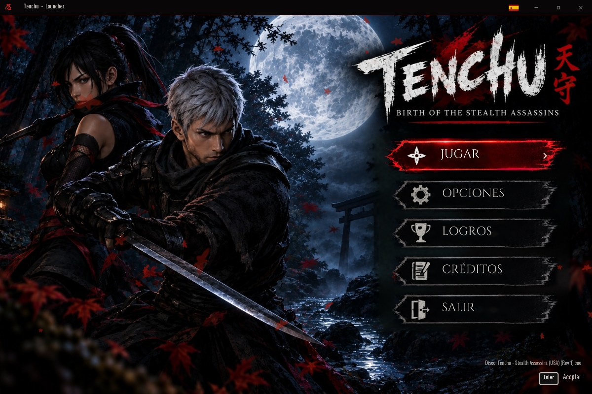

<h1 align="center">🥷 Kage no Michi 「影の道」</h1>

<p align="center">
  <b>El Camino de las Sombras</b><br>
  Un lanzador para Linux y Windows que convierte tu copia de <i>Tenchu: Stealth Assassins</i> de PlayStation<br>
  en un juego que se abre como cualquier programa, ahora con subtítulos en español y voces japonesas.
</p>

<p align="center">
  <a href="../../actions/workflows/appimage.yml"></a>
  
  
  
  
</p>

<p align="center">
  
</p>

> [!NOTE]
> **En desarrollo.** Kage no Michi nace de [Kage no Mon](https://github.com/daetrox/kage-no-mon), el
> launcher de *Tenchu 2*. La cámara libre, el movimiento 360°, fijar enemigo, los iconos de botones dentro
> del juego y los trucos todavía no están adaptados a este juego.

---

## 🏯 ¿Qué es esto?

**Kage no Michi** es un *launcher* (lanzador): una pequeña aplicación con su propio menú, música y
animaciones que lleva dentro un emulador de PlayStation muy preciso. Tú solo ves **un juego**:
abres el programa, pulsas **JUGAR** y estás dentro.

> [!IMPORTANT]
> **No incluye el juego.** Necesitas tu propia copia de *Tenchu: Stealth Assassins* (imagen del disco).
> La BIOS no hace falta: viene integrada **OpenBIOS**, una BIOS libre. Si lo prefieres, puedes
> usar la de tu propia consola.

---

## ✨ Características

| | |
|---|---|
| 🇪🇸 **Subtítulos en español** | Las escenas de las misiones, traducidas al español y dibujadas con la propia fuente del juego. |
| 🇫🇷🇮🇹 **Francés e italiano** | El disco americano esconde los subtítulos europeos: el launcher los recupera. |
| 🇯🇵 **Voces japonesas** | Las voces originales japonesas de las escenas, un secreto del disco americano. |
| ✨ **Gráficos mejorados** | Hasta 5× la resolución original, texturas suavizadas (xBR) y polígonos sin temblores. |
| 🎮 **Teclado, Xbox o PlayStation** | Los iconos de los botones del launcher cambian solos según lo que uses. |
| 🏆 **Logros sin conexión** | Logros de RetroAchievements: los descargas una vez y después se juegan *offline*. |
| 🇪🇸🇺🇸 **Español e inglés** | Cambia el idioma del launcher con la bandera de arriba a la derecha. |

El idioma de las voces y de los subtítulos se elige en **OPCIONES › Idioma**. Funciona con la versión
americana del juego (**SLUS-00706**).

---

## 🚀 Empieza en 3 pasos

### 1️⃣ Descarga el launcher
Entra en **[Releases](../../releases/latest)** y descarga:

- 🐧 **Linux:** `KageNoMichi-…-x86_64.AppImage`
- 🪟 **Windows 10/11:** `KageNoMichi-…-windows-x64.zip` (descomprímelo donde quieras)

<sub>¿Todavía no hay ninguna versión publicada? En la pestaña **[Actions](../../actions)** abre la
última compilación correcta ✅ y descarga el paquete desde *Artifacts* (requiere iniciar sesión en GitHub).</sub>

### 2️⃣ Prepara una carpeta
Crea una carpeta donde quieras y deja dentro el AppImage y tu disco así:

```
📁 Kage no Michi/
├── 🥷 KageNoMichi-x86_64.AppImage
├── 📁 game/
│   ├── Tenchu - Stealth Assassins (USA).cue   ← imagen de tu disco (.cue + .bin, o .chd)
│   └── Tenchu - Stealth Assassins (USA).bin
└── 📁 bios/                  ← (opcional) BIOS de tu consola, si no quieres usar OpenBIOS
    └── scph5501.bin
```

<sub>En Windows la carpeta ya viene así dentro del `.zip`, con `KageNoMichi.exe` en lugar del AppImage.</sub>

### 3️⃣ ¡A jugar!
**Linux:** haz doble clic en el AppImage. Si no se abre, dale permiso de ejecución primero:

```sh
chmod +x KageNoMichi-*.AppImage
./KageNoMichi-*.AppImage
```

**Windows:** abre `KageNoMichi.exe`. Si aparece «Windows protegió su PC», pulsa **Más información ›
Ejecutar de todas formas** (el programa no está firmado digitalmente).

> [!TIP]
> También puedes **arrastrar** la imagen del disco o la BIOS sobre la ventana del launcher,
> o elegirlas desde **OPCIONES › ISO y BIOS**.

---

## 🎮 Controles

| Acción en el juego | ⌨️ Teclado | 🎮 Mando |
|---|---|---|
| Moverse | Flechas | Stick izquierdo / cruceta |
| ✕ · ◯ · □ · △ | `Z` · `X` · `A` · `S` | Botones de abajo · derecha · izquierda · arriba |
| L1 · R1 · L2 · R2 | `Q` · `W` · `E` · `R` | Bumpers y gatillos |
| Start · Select | `Enter` · `Retroceso` | Start · Back |
| **Abrir la pausa** | `Esc` | **L3 + R3** a la vez, o el botón central |
| Guardar / cargar rápido | `F5` / `F7` | Desde el menú de pausa |
| Pantalla completa | `F11` o `Alt+Enter` | — |

> [!TIP]
> Puedes cambiar cualquier tecla o botón en **OPCIONES › Controles › Personalizar teclado / mando**.
> Teclado y mando se configuran por separado, y **Restaurar controles por defecto** lo deja todo como al principio.

---

## 🏆 Logros

1. En el menú, entra en **LOGROS**.
2. Inicia sesión **una sola vez** con tu cuenta gratuita de [RetroAchievements](https://retroachievements.org).
3. Se descargan los logros y sus insignias. **A partir de ahí funcionan sin internet.**

Al final de la lista está **Reiniciar mis logros**, para empezar de cero (pide confirmación).

<sub>🔒 Tu contraseña solo se usa para obtener un token de acceso y no se guarda. Los logros que
consigues se guardan en tu equipo y no se envían a RetroAchievements.</sub>

---

## ❓ Preguntas frecuentes

<details>
<summary><b>¿Por qué no viene con el juego? ¿Y la BIOS?</b></summary>

El juego tiene derechos de autor de sus dueños: cada persona debe usar su propia copia.
En lugar de la BIOS de Sony se incluye **OpenBIOS**, una BIOS libre (MIT) que funciona con este
juego. Si quieres la original, copia la de tu consola en `bios/` y elígela en
**OPCIONES › ISO y BIOS** (o usa *Cargar BIOS nueva…*).
</details>

<details>
<summary><b>¿Qué versiones del juego funcionan?</b></summary>

Cualquier versión de *Tenchu: Stealth Assassins* para PlayStation debería arrancar. Las voces japonesas
y los subtítulos en español, francés e italiano necesitan la versión americana (**SLUS-00706**).
</details>

<details>
<summary><b>¿Por qué en español faltan los signos ¿ y ¡?</b></summary>

Los subtítulos se dibujan con la fuente del propio juego, que tiene las vocales con tilde y la ñ, pero no
los signos de apertura. Está previsto añadirlos.
</details>

<details>
<summary><b>¿Dónde se guardan mis partidas?</b></summary>

- Tarjetas de memoria y guardados rápidos: `~/.local/share/kagenomichi/`
- Configuración: `~/.config/kagenomichi/config.ini`
</details>

---

## 🛠️ Compilar desde el código

<details>
<summary>Instrucciones para desarrolladores</summary>

Requisitos: `git`, `cmake`, `ninja`, `g++` y las cabeceras de SDL2 para X11/Wayland/OpenGL/PulseAudio.

```sh
./build.sh                       # compila SDL2, el núcleo SwanStation y el launcher → build/dist/
packaging/make_appimage.sh dev   # empaqueta build/dist como AppImage
./build-windows.sh --package     # versión de Windows (compilación cruzada con llvm-mingw) → .zip
```

GitHub Actions (`.github/workflows/appimage.yml`) compila el AppImage y el `.zip` de Windows en cada
cambio y los publica como Release al crear una etiqueta `vX.Y.Z`.

| Carpeta | Contenido |
|---|---|
| `src/` | Launcher en C++ (SDL2 + OpenGL 3.3): menús, frontend libretro, logros, audio |
| `patches/` | Parche de SwanStation (GPL-3.0) para cambiar los iconos de botones del juego |
| `assets/` | Fuentes, shaders, imágenes de la interfaz y audio |
| `tools/` | Scripts que generan el arte (`make_assets.py`), la música (`make_audio.py`) y las traducciones (`make_translation.py`) |
| `packaging/` | Icono, acceso directo y script del AppImage |

Para retocar el arte en vivo, edita `assets/shaders/*.frag` con el launcher abierto y pulsa **F9**.
</details>

---

## ⚖️ Licencia y créditos

- 🥷 **Kage no Michi** — software libre bajo **GPL-3.0**, sin fines de lucro.
- 🎮 **[SwanStation](https://github.com/libretro/swanstation)** — núcleo de emulación (GPL-3.0).
- 🧩 **[OpenBIOS](https://github.com/pcsx-redux/nugget)** — BIOS libre de PCSX-Redux (MIT), integrada en el núcleo.
- 🏆 **[rcheevos](https://github.com/RetroAchievements/rcheevos)** — logros (MIT) · datos de [RetroAchievements](https://retroachievements.org).
- 🥷 **Trucos** — códigos de la comunidad recopilados en [chtdb](https://github.com/duckstation/chtdb) (ver `assets/cheats/CREDITOS.txt`).
- 🧱 **[SDL2](https://libsdl.org)** (zlib) · **[stb](https://github.com/nothings/stb)** (dominio público).
- 🔤 Fuentes: Cinzel, Oswald, Shojumaru, Kaushan Script y Yuji Syuku (SIL OFL 1.1).
- 🎵 Música y efectos: composición original generada con `tools/make_audio.py`.

<sub>*Tenchu* es una marca registrada de sus respectivos propietarios. Este proyecto no está
afiliado ni respaldado por ellos.</sub>

<p align="center">⛩️ <i>Vive con honor, mata con sigilo.</i> ⛩️</p>
